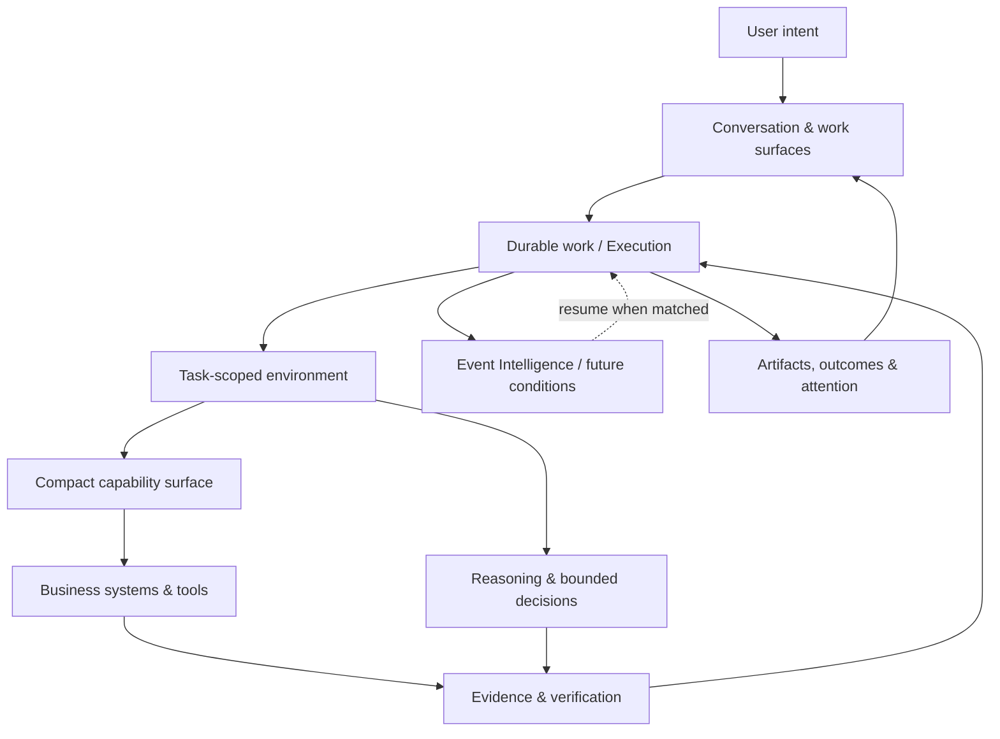

# Artemis
### An architecture for AI-native work, not just agent conversations.

**Artemis** is an experimental product and runtime architecture developed under **Underlay**. Its direction is simple to state and difficult to implement: turn a person's intent into governed work that can interact with real systems, survive interruptions, and produce outcomes that can be checked.

Most agent demonstrations end when the model responds. Business work often does not.

**An essential design choice:** one persistent Workspace should let people navigate different work surfaces without having to create separate chat silos. Context is assembled dynamically from the current intent, focus, authorized sources and task state; the global conversation is not the model's entire context. [Explore the Workspace model](docs/00-ONE-WORKSPACE.md).

> **Intent in. Interface out. Action done.**

This repository is a **public technical reading room**, not the Artemis source code, SDK, deployment guide, or complete engineering specification. It explains selected architectural ideas, the tensions behind them, and the boundaries they are meant to preserve.

**Project stage:** active development. Some principles already have implementations or prototypes; the more ambitious unified architecture is an accepted design direction under incremental development. See [Architecture status](docs/STATUS.md). Nothing in these notes guarantees that a described capability is live in the product.

## The architectural shift

| Common agent assumption | Artemis design direction |
| --- | --- |
| Every project lives in its own chat | **One Workspace and global conversation**, with focus and context changing as work changes |
| The conversation is the unit of work | A durable **Execution** owns work; conversation is an interaction channel |
| An agent receives a long list of tools | A compact capability surface discovers task-relevant, permitted operations |
| An LLM keeps checking until something changes | **Event Intelligence** expresses future conditions and wakes dormant work |
| Every step should use open-ended reasoning | Deterministic operations, bounded decisions, and open reasoning have different roles |
| The model's final message means success | Completion depends on **verification and evidence** |
| A single agent or predefined team owns everything | Work can be decomposed and composed when independence actually justifies it |
| A fixed UI is the only control surface | **Work surfaces** can be composed around user intent and durable results |

These are design choices, not claims that Artemis invented the underlying concepts. The interesting part is how they fit together without transferring authority to a model.

## A system in one picture

*Conceptual illustration, not an implementation topology.*

## Read the design notes

Start with **[The architectural signatures](docs/DESIGN-PRINCIPLES.md)** for the complete map, or read the chapters in order.

1. **[One Workspace, changing context](docs/00-ONE-WORKSPACE.md)** — a single global conversation, independent surfaces and a task-specific context that follows the user's work.
2. **[Why work needs more than a chat loop](docs/01-WORK-AS-THE-PRIMITIVE.md)** — conversation, Execution, Case, and the distinction between user interaction and task ownership.
3. **[A compact capability fabric](docs/02-CAPABILITY-FABRIC.md)** — semantic capabilities, narrow discovery surfaces, dynamic access, and protocol-independent operations.
4. **[Event Intelligence and dormant work](docs/03-EVENT-INTELLIGENCE.md)** — temporal conditions, correlation, wake/resume, and why a model should not spend compute waiting.
5. **[Continuation rather than endless prompting](docs/04-CONTINUATION.md)** — multiple types of work, delegation, external dependencies, and verified termination.
6. **[Adaptive cognition](docs/05-ADAPTIVE-COGNITION.md)** — when to compute, decide, reason, escalate, or ask.
7. **[Context, memory, and trust](docs/06-CONTEXT-AND-TRUST.md)** — task-specific context with evidence, provenance, and separate authority.
8. **[Governed action and verifiable outcomes](docs/07-AUTHORITY-AND-VERIFICATION.md)** — why an authorized action and a correct answer are different things.
9. **[Interfaces shaped by work](docs/08-EXPERIENCE.md)** — work surfaces, artifacts, attention, and intent-driven UI.
10. **[One end-to-end example](docs/09-EXAMPLE.md)** — a hypothetical business exception spanning tools, time, and human decisions.
11. **[Adaptive teams](docs/10-ADAPTIVE-TEAMS.md)** — how the smallest suitable worker/team can evolve when the task changes.
12. **[Skills, knowledge and governed learning](docs/11-SKILLS-AND-LEARNING.md)** — capability versus expertise versus memory, and controlled reusable improvement.
13. **[Cases and automations](docs/12-CASES-AND-AUTOMATION.md)** — long-lived business continuity beyond individual tasks.
14. **[Operational explainability](docs/13-OPERATIONAL-EXPLAINABILITY.md)** — inspectable outcomes and evidence rather than reconstructed model reasoning.
15. **[Reliable autonomy](docs/14-RELIABLE-AUTONOMY.md)** — differentiated compute, recoverability and responsiveness.
16. **[Status and disclosure scope](docs/STATUS.md)** — what is implemented, what is a target, and what stays private.

## What Artemis is not

Artemis is not another catalog of agent prompts. It is not a replacement for MCP, an ERP system, or a claim that every activity requires a multi-agent team. It is also not a public reference implementation or a specification others can assume is stable.

There are trade-offs. Durable work creates state and recovery complexity. Context isolation creates engineering constraints. Event-driven operation requires correlation and safe resumption. Verification is expensive but necessary where a task changes a business system. These trade-offs are discussed throughout the notes.

## Related research and experiments

- **[MCP Event Intelligence](https://github.com/sarooo17/event-intelligence)** is a separately published project exploring persistent event conditions for agent runtimes. It has **its own license**. Its public implementation is not part of this repository's proprietary license.
- **[Underlay](https://underlay.studio)** — project and product context.
- **[Underlay Memos](https://memos.underlay.studio)** — engineering writing and experiments.

## Access, copyright, and contributions

**Source-available to read is not open source.** This repository intentionally contains *documentation only*; the underlying Artemis implementation is not published here.

**Copyright © 2026 Riccardo Saro. All rights reserved.** See [LICENSE](LICENSE) and [NOTICE](NOTICE.md). No general rights to reproduce, modify, redistribute, commercialize, or incorporate these documents are granted beyond applicable law and the functionality permitted by GitHub's Terms of Service.

Development is owner-maintained. **External issues, pull requests, and contributions are not accepted.** This is a documentation publication, not a collaboration or support channel.
